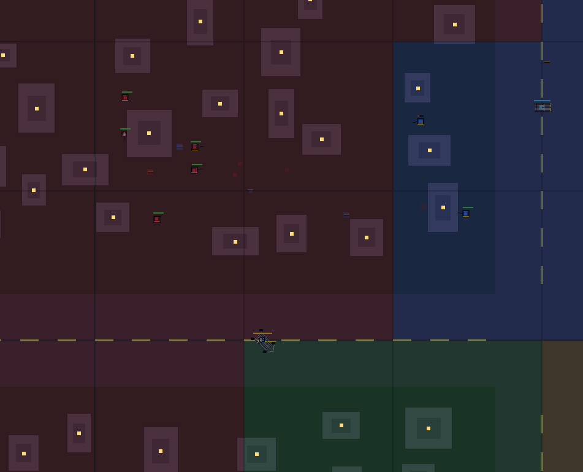
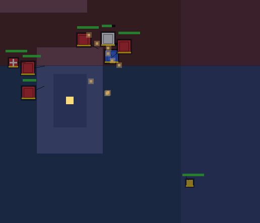

# CARTEL SIMULATOR 2D




Top-down procedural cartel territory sim. C++17 + SDL2 only. No external assets. Font bitmap propria.

## License
MIT — see `LICENSE`.

## Build
```bash
cmake -B build
cmake --build build
./build/cartel_sim
```

Deps: `libsdl2-dev` (`sudo apt install libsdl2-dev cmake g++`).

## Controles
- WASD / setas: move camera
- Arrasto botao esquerdo: move camera
- Wheel / Q/E: zoom
- ESPACO: speedup 1X/2X/4X, canto tela
- ESC: sair

## Sim
- 4 carteis, 10x10 territorios, ~220 casas, estrada cruzada, grid visivel
- Armas: pistola (280, 0.6s) + AK47 (420, 0.28s burst) + SNIPER (650, 1.5s, 60dmg)
- Classes: LIGHT 80hp rapido / HEAVY 180hp AK tank / SNIPER 70hp kite 300-550 / MEDIC 90hp cura 15/s
- Mansao: compound murado torres/portao/vila/piscina/jardim trim cor
- NPC: pernas animadas, cabeca + marca classe, sombra
- Pathfinding A* grade 32x32 + fallback estrada, probe desvio parede, anti-manada, sem grude
- Carros: 8 ruas + blindado compravel (500hp, metralhadora 380, reparo base), entrar/sair, drive estrada 340, ram 60, wreck 12s
- Base AI: compra squad 400 / blindado 800 max2 / upg 600 max3 (+20% dano/hp), backup auto ao perder
- Guerra territorial direta entre os 4 cartéis (nada de policia/marinha/heat por enquanto)
- Backup: chamado reforco local + squad base, autosave backup.dat 30s + load boot
- Som: mp3 por nome exato (pistola/AK/machine), mixer SDL puro, volume cai com distancia + pan, max 6/frame
- HUD: nome, $ Uupg, terr, NPC, AK, BLD, relogio + tracer
- Papel: GUARDA segura territorio / invasor captura, por NPC, faixa branca
- Papo: dupla aliada em territorio proprio conversa (bolha ...), de vez em quando, dia alto / noite raro
- Terror: noite 18-5 visao 1.25x dano 1.2x / tarde 12-18 1.1x / manha calmo 0.9x
- Luta: foge só perdendo trade, bloodlust +30 vel, carro abandona 3 travas
- Ruas: 10 civis sem colisao, loop infinito, faixa por sentido, sem carro parado. Wreck volta p/ base
- Mapa 4800 HQ folgados, A* 48, 450 casas, 16/cartel
- (viatura/sirene/forcas/ocorrencias removidos)
- Tags: pichacao cor do cartel em territorio dominado (xadrez)
- Monstruo v2 refs: chapas, ariete com dentes, torre anel, pneu estepe, grafite
- Impacto: faiscas particulas em parede/carro/NPC + luz noturna
- Captura: so um time presente por ~2.5s -> flip cor + $150
- Dinheiro: $5 + $4/territorio por seg + eventos a cada 10s (inclui drop AK)
- Respawn em territorio proprio ate 14 vivos, 30-40% AK
- Dia/noite ~120s: overlay + luzes casas/mansoes
- HUD: nome, dinheiro, terr, NPC vivos, AK vivos, relogio + tracer tiro
